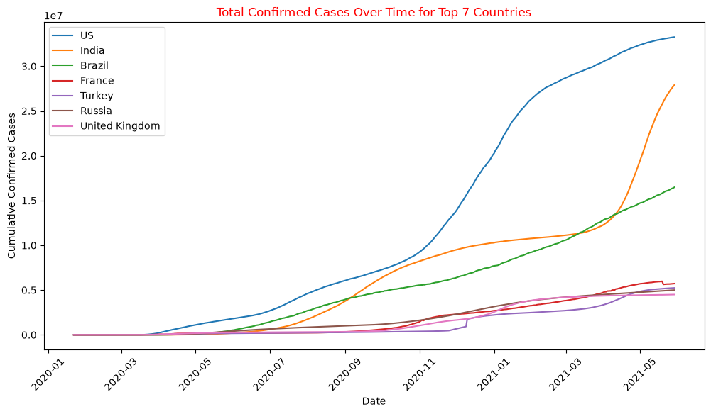
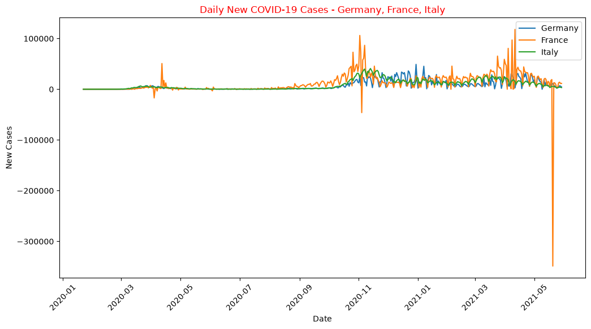
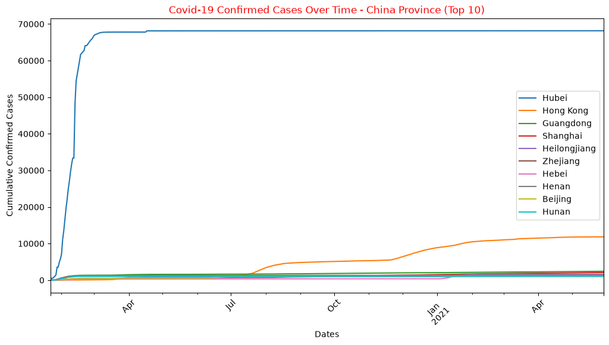
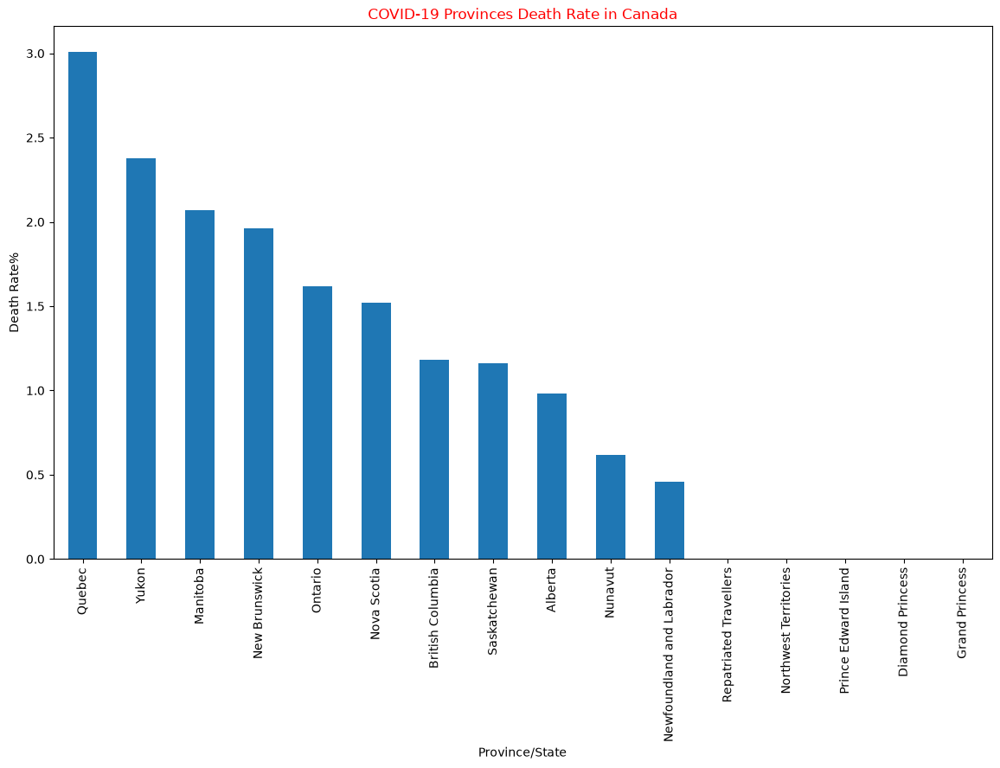
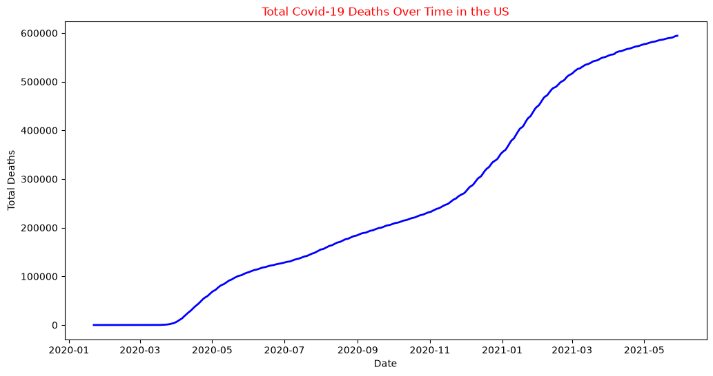
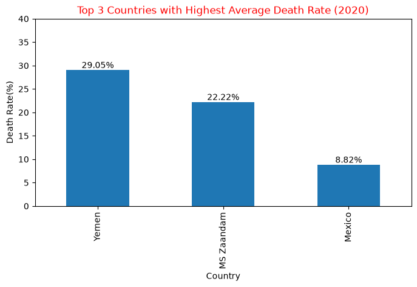
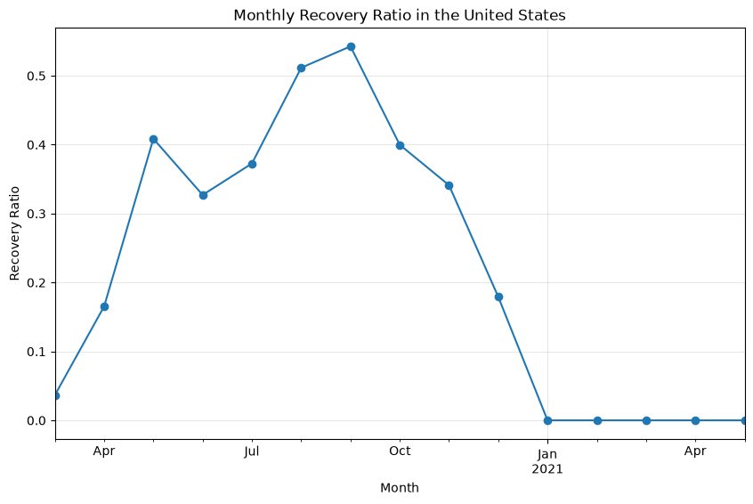

# COVID-19 Data Analysis with Python


An end-to-end exploratory analysis of the COVID-19 pandemic using **pandas, NumPy and Matplotlib**. Three messy, wide-format time series (confirmed cases, deaths, recoveries) for **276 regions over 494 days** are reshaped, cleaned, merged and analysed to answer 19 questions about how the virus spread, who recovered and where it was deadliest.

**Headline:** The US led with 33.25M cases, and France had Europe's biggest single-day surge (117,900). The highest death rates mostly reflect low testing, not a deadlier virus.

**[📓 Open the notebook](covid_19_case_study.ipynb)** · **[Interactive case file](https://parthdhawan921-ops.github.io/Parth_Personal/#covid)**



---

## 📑 Contents

- [Key Findings](#-key-findings)
- [Dataset](#-dataset)
- [Workflow](#️-workflow)
- [Questions Answered](#-questions-answered)
- [Visualisations](#-visualisations)
- [Skills Demonstrated](#-skills-demonstrated)
- [Limitations](#️-limitations)
- [How to Run](#️-how-to-run)
- [Author](#-author)

---

## 💡 Key Findings

| Question | Finding |
|---|---|
| Most confirmed cases (29 May 2021) | **US 33.25M**, India 27.89M, Brazil 16.47M |
| Highest single-day surge (Germany, France, Italy) | **France: 117,900 new cases** on 11 Apr 2021 |
| Recovery rate, Canada vs Australia (31 Dec 2020) | **Canada 84.47%** vs Australia 79.38% |
| Deadliest Canadian province | **Quebec, 3.01%** death rate |
| Most total deaths | **US 594,306**, Brazil 461,057, India 325,972 |
| Highest average daily deaths | **US 1,203/day**, Brazil 933, India 660 |
| Highest death rate in 2020 | Yemen 29.05%, MS Zaandam 22.22%, **Mexico 8.82%** |
| South Africa outcomes | **1,554,184 recoveries vs 56,363 deaths**, about 27 to 1 |
| Best US recovery-ratio month | **September 2020** (0.54) |

**What stands out**

- **India's second wave was the steepest climb in the data.** Cases went from about 11M to 28M between March and May 2021.
- **A high death rate often means low testing rather than a deadlier virus.** Yemen recorded only 2,100 cases in 2020, so mostly severe cases were counted. Mexico's 8.8% across 1.4M cases points to under-testing and strain on hospitals.
- **Recovery data is the least reliable of the three series.** The US stopped reporting recoveries in 2021, so its ratio drops to 0. India's ratio rises above 1 when recoveries from an earlier wave are reported against fewer new cases.

---

## 📊 Dataset

Daily **cumulative** counts in the Johns Hopkins University CSSE time-series format, from **22 Jan 2020 to 29 May 2021**:

| File | Rows × columns | Content |
|---|---|---|
| `covid_19_confirmed.csv` | 276 × 498 | Confirmed cases |
| `covid_19_deaths.csv` | 276 × 498 | Deaths |
| `covid_19_recovered.csv` | 261 × 498 | Recoveries |

Each file has `Province/State`, `Country/Region`, `Lat` and `Long`, plus **one column per date** (wide format). The data has real-world problems to fix: blank provinces, missing coordinates, mixed date formats (`1/22/20` and `02-01-2020`), and countries split into provinces.

> The three CSVs are included in this repository, so the notebook runs as-is. The original data is published by [JHU CSSE](https://github.com/CSSEGISandData/COVID-19) (`csse_covid_19_data/csse_covid_19_time_series`). The notebook also keeps all its outputs, so every result and chart is visible on GitHub without running it.

---

## ⚙️ Workflow

```text
3 wide CSVs ──► Melt (wide → long) ──► Clean ──► Aggregate to country/day ──► Merge ──► Analyse & visualise
                ~130K rows each        NaN, types,   sum provinces            95,342 rows
                                       mixed dates                            × 5 columns
```

1. **Load** the three datasets with `pd.read_csv`.
2. **Reshape** from wide to long with `pd.melt`: one row per region per day.
3. **Clean:**
   - fill blank provinces with `"All Provinces"`;
   - set missing coordinates and counts to 0;
   - parse mixed date formats with `pd.to_datetime(format="mixed")`;
   - cast counts to `int64`.
4. **Aggregate** provinces to one row per country per day with `groupby().sum()`.
5. **Merge** confirmed, recovered and deaths on `Country/Region` and `Date`.
6. **Derive daily values** from the cumulative series with `groupby().diff()`, clipping negative corrections. Then roll them up to monthly totals with `dt.to_period("M")`.
7. **Analyse and visualise:** peaks, rates, rankings and trends, with a written observation for each question.

---

## ❓ Questions Answered

| Section | Questions |
|---|---|
| **1. Data loading** | Load the confirmed, deaths and recovered datasets |
| **2. Exploration** | Dataset structure · confirmed cases over time for the top 7 countries · China at country and province level |
| **3–4. Cleaning** | Identify and impute missing values · fill blank provinces |
| **5. Country analysis** | Peak daily cases in Germany, France and Italy · Canada vs Australia recovery rates · death-rate spread across Canadian provinces |
| **6. Transformation** | Wide → long with datetime dates · total deaths per country · top 5 by average daily deaths · US deaths over time |
| **7. Merging** | Merge all three datasets · monthly confirmed, deaths and recoveries · trends for the US, Italy and Brazil |
| **8. Combined analysis** | Highest 2020 death rates · South Africa recoveries vs deaths · US monthly recovery ratio, plus an extra comparison for India |

---

## 📈 Visualisations

| | |
|---|---|
|  |  |
| **Daily new cases:** Germany, France, Italy | **China:** top 10 provinces |
|  |  |
| **Death rate by Canadian province** | **US cumulative deaths** |
|  |  |
| **Highest death rates in 2020** | **US monthly recovery ratio** |

All 11 charts are in [`images/`](images/).

---

## 🧠 Skills Demonstrated

| Area | Techniques |
|---|---|
| **Data wrangling** | `melt`, `pivot`, `merge`, `groupby`, `join`, `query`, `nlargest`, `idxmax` |
| **Data cleaning** | Missing-value imputation, type conversion, mixed-format date parsing |
| **Time series** | Cumulative → daily with `diff()`, `clip()` for data corrections, monthly resampling with `to_period` |
| **Analysis** | Peak detection, recovery and death rates, rankings, period comparisons |
| **Visualisation** | Line charts, bar charts with labels, multi-series plots in Matplotlib |
| **Analytical judgement** | Spotting misleading metrics, e.g. why the mean of cumulative deaths is *not* average daily deaths (both approaches are shown) |

---

## ⚠️ Limitations

- **Reporting differs by country.** Testing levels, death definitions and recovery reporting vary, so cross-country rates are indicative, not exact.
- **Data corrections create negative daily values**, e.g. France about −350K in May 2021. These are clipped to 0 in the monthly analysis.
- **Recovery reporting stopped** for some countries (the US from 2021), which makes later recovery ratios unreliable.
- **Small samples distort rates**: MS Zaandam is a cruise ship with 9 cases.

---

## ▶️ How to Run

```bash
git clone https://github.com/parthdhawan921-ops/covid-19-data-analysis.git
cd covid-19-data-analysis
pip install -r requirements.txt
```

```bash
jupyter notebook covid_19_case_study.ipynb
```

The datasets are already in the repository folder. A full run takes under a minute and reproduces every output and chart.

---

## 👨‍💻 Author

**Parth Dhawan**: Data Analyst · SQL · Python · Excel · Power BI

[GitHub](https://github.com/parthdhawan921-ops) · [LinkedIn](https://www.linkedin.com/in/parth-dhawan-31516127a/)
